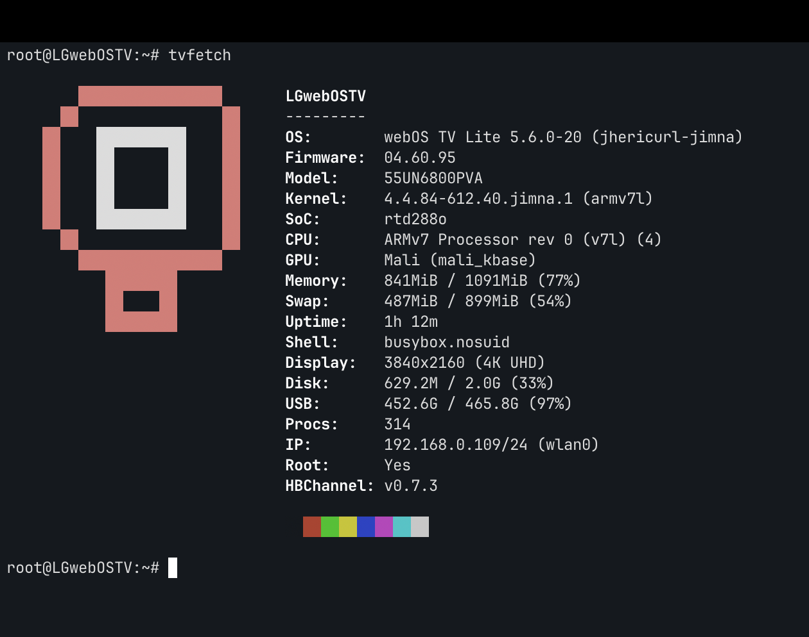

# tvfetch

neofetch-style system info display for LG webOS TVs. Run it over SSH to get a quick overview of your TV's hardware, OS, memory, network, and more.



## Install

```sh
# Copy to TV
scp tvfetch root@<TV_IP>:/usr/local/bin/
ssh root@<TV_IP> 'chmod +x /usr/local/bin/tvfetch'

# Run
ssh root@<TV_IP> tvfetch
```

Or run without installing:

```sh
ssh root@<TV_IP> 'sh -s' < tvfetch
```

## Output

Displays: webOS version, firmware, model, kernel, SoC, CPU, GPU, memory, swap, uptime, shell, display resolution, disk usage, USB storage, process count, IP address, root status, and Homebrew Channel version — with an ASCII art LG TV logo.
